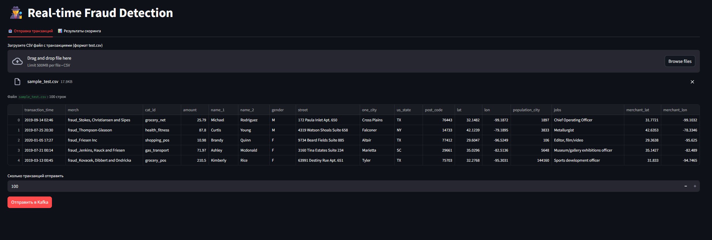
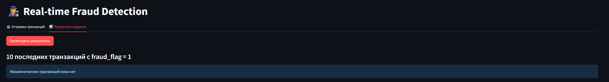
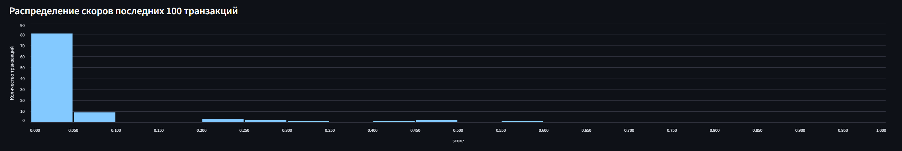

# Real-Time Fraud Detection (Kafka + CatBoost + Postgres)

Сервис скоринга фродовых транзакций в реальном времени: транзакции приходят потоком
из Kafka, проходят препроцессинг и скоринг моделью CatBoost (только CPU, только inference),
результаты пишутся обратно в Kafka и сохраняются в Postgres. В Streamlit-интерфейсе можно
отправить транзакции и посмотреть результаты.

## Архитектура

```
 interface (Streamlit) ──► [transactions] ──► fraud_detector ──► [scores] ──► score_writer ──► Postgres
        ▲                                                                                      │
        └──────────────────────── «Посмотреть результаты» ◄──────────────────────────────────────┘
```

| Сервис | Назначение |
|---|---|
| `zookeeper`, `kafka` | брокер сообщений |
| `kafka-setup` | создаёт топики `transactions` и `scores` и завершается |
| `kafka-ui` | веб-интерфейс Kafka — http://localhost:8080 |
| `fraud_detector` | читает `transactions`, делает препроцессинг и скоринг, пишет в `scores` |
| `score_writer` | читает `scores` (`transaction_id`, `score`, `fraud_flag`) и пишет в Postgres |
| `postgres` | витрина `fraud_scores` (создаётся `postgres/init.sql`) |
| `interface` | Streamlit UI — http://localhost:8501 |

Этапы ML-пайплайна внутри `fraud_detector` разнесены по отдельным скриптам:

- `app/app.py` — чтение сообщений из Kafka и выгрузка скора и флага фрода в Kafka;
- `src/preprocessing.py` — препроцессинг (временные признаки, топ-50 кодирование категорий,
  mean-encoding, расстояние клиент–мерчант, импьютация, log-преобразование);
- `src/scorer.py` — загрузка модели `models/my_catboost.cbm` и скоринг (порог 0.98).

Все статистики, которые раньше считались по `train.csv` при старте контейнера, заранее
сохранены в лёгкий файл `fraud_detector/artifacts/preproc_artifacts.json`. Поэтому для
запуска **не нужен train.csv**, а контейнер стартует за секунды.

## Быстрый старт

Требования: Docker 20.10+ и Docker Compose v2. Должны быть свободны порты 8080, 8501, 9095, 5433.

```bash
git clone <ссылка на этот репозиторий>
cd <папка репозитория>
docker compose up --build -d
docker compose ps        # kafka-setup должен быть в статусе Exited (0), остальные — Up
```

Первый запуск занимает несколько минут (скачивание образов и сборка).

## Проверка работоспособности

1. Откройте http://localhost:8501, вкладка **«Отправка транзакций»**.
2. Загрузите `data/sample_test.csv` (100 транзакций из `test.csv` соревнования) или
   любой файл формата `test.csv`, выберите количество строк и нажмите **«Отправить в Kafka»**.
3. В Kafka UI (http://localhost:8080 → Topics → `scores` → Messages) появятся сообщения вида:
   ```json
   {"transaction_id": "d6b0f7a0-8e1a-4a3c-9b2d-5c8f9d1e2f3a", "score": 0.0123, "fraud_flag": 0}
   ```
4. Перейдите на вкладку **«Результаты скоринга»** и нажмите **«Посмотреть результаты»**:
   - 10 последних транзакций с `fraud_flag = 1` (если такие есть);
   - гистограмма распределения скоров последних 100 транзакций.

## Скриншоты работы сервиса

**Отправка транзакций** (загружен `data/sample_test.csv`, 100 строк):



**1. 10 последних транзакций с `fraud_flag == 1` из Postgres.** На 100 тестовых транзакциях
ни одна не превысила порог модели 0.98, поэтому интерфейс сообщает, что таких записей нет:



**2. Гистограмма распределения скоров последних 100 транзакций:**



Проверить базу напрямую:

```bash
docker compose exec postgres psql -U fraud -d fraud \
  -c "SELECT COUNT(*), SUM(fraud_flag) FROM fraud_scores;"
```

Логи сервисов:

```bash
docker compose logs -f fraud_detector score_writer
```

Остановка (`-v` дополнительно удаляет данные Postgres):

```bash
docker compose down -v
```

## Витрина в Postgres

```sql
fraud_scores (
    id             BIGSERIAL PRIMARY KEY,
    transaction_id TEXT UNIQUE,
    score          DOUBLE PRECISION,
    fraud_flag     SMALLINT,          -- 0 / 1
    created_at     TIMESTAMPTZ DEFAULT now()
)
```

Подключение с хоста: `localhost:5433`, БД / пользователь / пароль — `fraud`.

## Пересборка артефактов препроцессинга (опционально)

Нужна только при смене обучающих данных. Положите `train.csv` из соревнования в
`fraud_detector/train_data/` и выполните:

```bash
cd fraud_detector
pip install pandas numpy geopy
python tools/build_artifacts.py --train train_data/train.csv
```

## Структура проекта

```
.
├── docker-compose.yml
├── data/sample_test.csv            # пример входных данных
├── docs/                           # скриншоты для README
├── postgres/init.sql               # создание витрины
├── fraud_detector/
│   ├── app/app.py                  # Kafka consumer/producer
│   ├── src/preprocessing.py        # препроцессинг
│   ├── src/scorer.py               # модель и скоринг
│   ├── tools/build_artifacts.py    # офлайн-подготовка артефактов
│   ├── artifacts/preproc_artifacts.json
│   ├── models/my_catboost.cbm
│   ├── requirements.txt
│   └── Dockerfile
├── score_writer/                   # Kafka -> Postgres
│   ├── app.py
│   ├── requirements.txt
│   └── Dockerfile
└── interface/                      # Streamlit UI
    ├── app.py
    ├── requirements.txt
    └── Dockerfile
```
